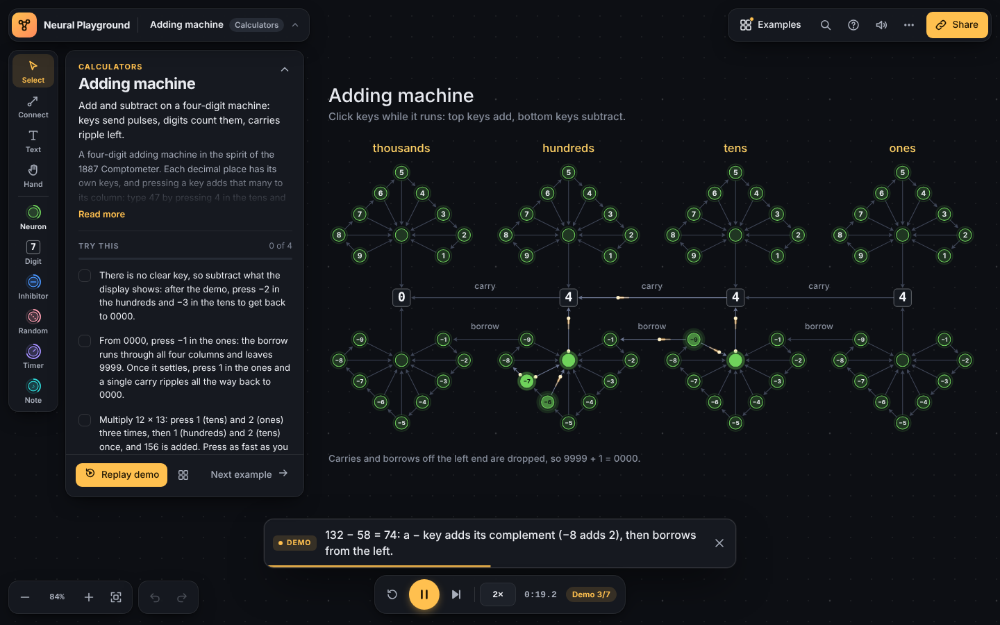

# Neural Playground

Place neurons on a grid, wire them together and watch charge pulse through
your network. Build counters, clocks, music boxes and a working adding
machine out of nothing but neurons that count and fire.

**[Open the playground →](https://rdsilver.github.io/neural-playground/)**



## How it works

Four rules, and everything else is built from them:

1. **Collect.** Each neuron holds a charge. Every pulse that reaches it adds
   one (or takes one away, if it came from an Inhibitor).
2. **Fire.** When the charge reaches the neuron's threshold, the charge
   resets to zero and the neuron fires a pulse down every outgoing
   connection.
3. **Travel.** Pulses move at four cells per second, so a longer connection
   is a longer delay. Layout is timing.
4. **Poke.** Click a neuron while the simulation runs to add one charge
   yourself. That's how you press the calculator's keys.

| Neuron | What it does |
| --- | --- |
| **Neuron** | Collects charge and fires at its threshold. |
| **Digit** | A neuron that shows its charge as a digit. Chain them with threshold 10 and you have a decimal counter. |
| **Inhibitor** | Fires negative pulses that remove charge. |
| **Random** | Sends each pulse down just one of its connections, chosen at random. |
| **Timer** | Fires on its own every few seconds, a set number of times or forever. |
| **Note** | Plays a note when it fires. |

## Examples

| Category | Example | |
| --- | --- | --- |
| Start here | [Hello, neurons](https://rdsilver.github.io/neural-playground/#example=hello-neurons) | Six tiny circuits, one idea each: a quick tour of every kind of neuron. |
| Calculators | [Adding machine](https://rdsilver.github.io/neural-playground/#example=adding-machine) | Add and subtract on a four-digit machine: keys send pulses, digits count them, carries ripple left. |
| Calculators | [Pulse dial](https://rdsilver.github.io/neural-playground/#example=pulse-dial) | A rotary telephone dial that adds: dial 7 and seven pulses reach the counter. |
| Calculators | [Times tables](https://rdsilver.github.io/neural-playground/#example=times-tables) | Nine multiplier ladders turn one count into a whole times table. |
| Calculators | [Division with remainders](https://rdsilver.github.io/neural-playground/#example=division-remainders) | A Digit with threshold d divides by d: its charge is the remainder. |
| Calculators | [Binary to decimal](https://rdsilver.github.io/neural-playground/#example=binary-to-decimal) | Press the keys for the 1 bits; a doubling chain does the rest. |
| Counting | [Digital clock](https://rdsilver.github.io/neural-playground/#example=digital-clock) | Minutes and seconds from four Digit neurons in bases 10 and 6. |
| Music | [Row, row, row your boat](https://rdsilver.github.io/neural-playground/#example=row-your-boat) | A four-voice round played by one chain of notes. |
| Music | [Polyrhythm: 3 against 4](https://rdsilver.github.io/neural-playground/#example=polyrhythm) | One clock divided by 3 and by 4 plays two rhythms at once. |
| Music | [Wandering melody](https://rdsilver.github.io/neural-playground/#example=wandering-melody) | Pulses wander up and down a pentatonic scale, one step at a time. |
| Patterns | [Flip-flop memory](https://rdsilver.github.io/neural-playground/#example=flip-flop) | A 1-bit memory: a pulse bouncing forever, with keys you cannot confuse. |
| Patterns | [Galton board](https://rdsilver.github.io/neural-playground/#example=galton-board) | Random pegs sort 256 balls into a bell curve. |
| Patterns | [Fireworks](https://rdsilver.github.io/neural-playground/#example=fireworks) | Rockets climb, bang and burst into round showers of sparks. |
| Classics | [Count to 1000 in bases 2–10](https://rdsilver.github.io/neural-playground/#example=count-to-1000) | Nine counters, one per base, all racing to 1000. |
| Classics | [Stable loops](https://rdsilver.github.io/neural-playground/#example=stable-loops) | Eight self-sustaining circuits that never stop once started. |
| Classics | [Bell curve](https://rdsilver.github.io/neural-playground/#example=bell-curve) | Pascal's triangle, built from neurons, piles up into a bell curve. |
| Classics | [Suppression](https://rdsilver.github.io/neural-playground/#example=suppression) | Inhibitory neurons keep a runaway square under control. |
| Classics | [A major scale](https://rdsilver.github.io/neural-playground/#example=a-major-scale) | A chain of Note neurons plays a scale every eight seconds. |
| Classics | [Random jamz](https://rdsilver.github.io/neural-playground/#example=random-jamz) | A Random neuron improvises on four notes. |

## Controls

**Mouse and touch.** Pick a neuron type from the left rail and click an empty
cell to place it. To connect two neurons, use the Connect tool or drag from
the small handle on a neuron's edge to another neuron (hold Shift for both
directions). While the simulation runs, clicking a neuron pokes it;
right-click, Shift-click or long-press to inspect it instead. Drag empty
space to pan; scroll or pinch to zoom.

| Key | Action | Key | Action |
| --- | --- | --- | --- |
| `Space` | Play / pause | `1`–`6` | Pick a neuron type |
| `.` | Step to the next event | `V` `C` `T` `H` | Select, Connect, Text, Hand tools |
| `R` | Reset | `N` / `Shift+N` | Select next / previous neuron |
| `[` `]` | Slower / faster | `Enter` | Poke the selection |
| `F` | Zoom to fit | `Delete` | Delete the selection |
| `E` | Examples | `Ctrl/⌘+Z` | Undo (`Shift` to redo) |
| `M` | Sound on / off | `Ctrl/⌘+K` | Command palette |
| `?` | Help and all shortcuts | `Ctrl/⌘+S` | Export JSON |

## Saving and sharing

Your network is saved in the browser as you work. **Share** copies a link
with the whole network compressed into the URL, so there is nothing to
upload. You can also export and import JSON files; files saved by the 2016
version still open.

## Development

```sh
npm ci
npm run dev        # http://localhost:5173
npm test           # engine, examples and UI logic (vitest)
npm run build      # type-check and build to dist/
```

`node scripts/snapshot.mjs <example-id|all> [seconds]` renders examples to
SVG/PNG without the app, handy when designing a new circuit.

There are no runtime dependencies: the app is TypeScript, Canvas 2D and the
DOM, built with Vite.

```
src/engine/    the simulation: deterministic, DOM-free and unit-tested
src/examples/  built-in examples, each with tests that prove what it claims
src/ui/        the app: board renderer, editor, inspector, panels, audio
```

The engine runs at a fixed 60 ticks per second, independent of frame rate,
so a network always behaves the same way. That is what lets every example
ship with tests (for instance, the adding machine is checked against plain
arithmetic for thousands of random keypresses).

### Adding an example

Write a function that builds the network with `NetworkBuilder`, add an entry
to one of the files in `src/examples/`, and write a test that runs it with
`Simulation` and checks the result. See `src/examples/calculator.ts` for a
fully worked one, including a scripted `demo`.

## Deployment

Pushes to `gh-pages` are tested, built and deployed to GitHub Pages by
`.github/workflows/deploy.yml`. In the repository settings, **Pages → Build
and deployment → Source** must be set to **GitHub Actions**.

## History

The first version (2016) was built with p5.js, jQuery and lodash, and
included the six "Classics" examples. In 2026 it was rewritten in TypeScript
with a new engine, editor and examples; the classic networks were converted
unchanged. The original code is in the git history.
